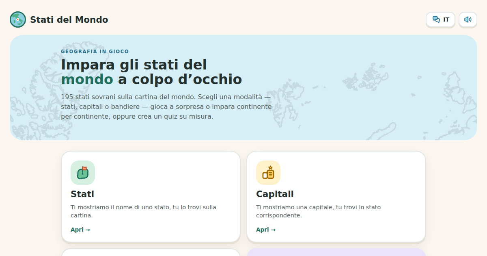

# Stati del Mondo – Countries of the World Quiz

An interactive map game to learn the 195 countries of the world, their capitals and flags. Available in Italian and English.

**▶ Play it here:** https://stati-del-mondo.vercel.app/ · English version: https://stati-del-mondo.vercel.app/en

## Features
- **Countries, Capitals, Flags:** find the right country on the world map
- **Learn mode:** study continent by continent, followed by a mini-quiz
- **Write them all:** type every country you remember
- **Custom quiz:** choose categories, continents and number of questions
- **Challenge mode:** 1–6 players, timed, spoken or written
- Filter by country size (all, top 150, top 100, top 30)

## About the project
I designed and built this game as a personal project to make learning geography faster and more fun.
It was built with the help of AI tools and deployed on Vercel.

## Tech
Single-page HTML/CSS/JavaScript app, hosted on Vercel.
